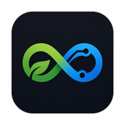
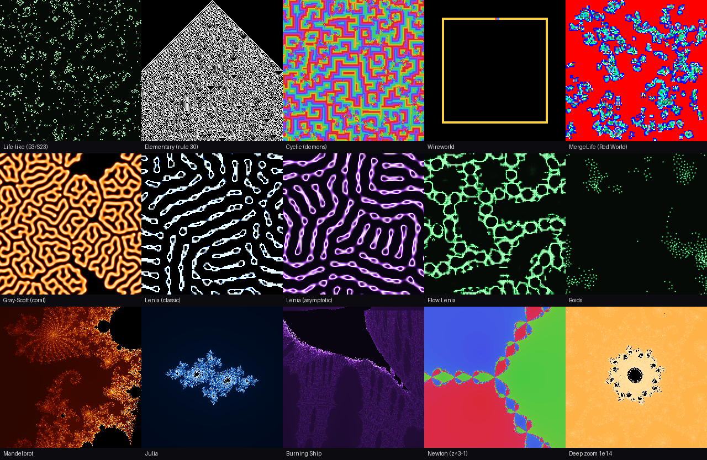

  

# heaton-life

*One tile per system, rendered by the library itself. Bottom right: the Mandelbrot set at a zoom of 10¹⁴.*

heaton-life is a library for exploring **emergence**: simple rules that give rise to
complex, organic-looking behavior. It brings the classic systems of artificial life
together in one place, with one consistent way to set them up, step them, and render
them:

| Family | Systems |
|---|---|
| Cellular automata | MergeLife, Life-like (Conway's Life and its relatives, with the History and Super variants), Generations, Larger than Life, rule tables (any `.rule` file), HashLife, Elementary, Cyclic, Wireworld |
| Lenia | Classic, Asymptotic, Flow |
| Fractals | Newton's basins, and Mandelbrot, Julia, and Burning Ship with perturbation deep zoom far beyond float64 (Mandelbrot and Julia to 10⁹⁰⁰⁰) |
| Boids | Reynolds flocking in 2D and 3D |
| Reaction-diffusion | Gray-Scott |

Life-like rules can be written in any common notation (B/S, isotropic, MAP, hexagonal,
and von Neumann), and most grids can wrap as a torus, Klein bottle, cross-surface, or sphere.
HashLife runs patterns of trillions of cells on an unbounded plane and can jump any
number of generations in a single step. There is also a genetic algorithm that evolves
new MergeLife rules, and a rendering pipeline that turns any system into still images
and, in Python, animated GIFs or MP4s.

What makes heaton-life different is that it is **specification first**. Every system
is defined by a language-neutral spec and pinned by a set of conformance vectors, and
two independent implementations, Python and .NET, are held to the same vectors. The
same parameters and seed give the same run in either language, which makes results
reproducible and lets the implementations check each other.

## Get the library

- **Python** (3.11+): `pip install heaton-life`. See the [Python README](python/README.md)
  for the API and a quick start, or open the
  [intro notebook](https://colab.research.google.com/github/jeffheaton/heaton-life/blob/main/python/examples/heaton_life_intro.ipynb)
  in Colab (also [viewable on GitHub](python/examples/heaton_life_intro.ipynb)). Includes
  an optional PyQt6 playground for exploring interactively.
- **.NET**: `dotnet add package HeatonLife.Core`, a dependency-free `netstandard2.1`
  assembly that runs anywhere .NET does, including Unity and IL2CPP. See the
  [.NET README](dotnet/README.md) for the API and a quick start.

## Apps

**Heaton Life** is a free app built on this library: every system above, on your
phone, tablet, or desktop. It is the easiest way to play with these systems, including
MergeLife, the cellular automaton I created.

- [App Store](https://apps.apple.com/us/app/heaton-life/id6804346957) (Mac, iPhone, iPad)
- [Microsoft Store](https://apps.microsoft.com/detail/9NS1693PBPVN) (Windows 10 and 11)
- [Google Play](https://play.google.com/store/apps/details?id=com.heatonresearch.heatonlife) (Android)

## Repository layout

| Path | Contents |
|---|---|
| [`spec/`](spec/) | Language-neutral algorithm specifications, the source of truth every implementation conforms to |
| [`vectors/`](vectors/) | Golden conformance vectors (parameters plus expected states) shared by all implementations |
| [`python/`](python/) | Python implementation (NumPy), the playground, the intro notebook, and the [development guide](python/DEVELOPMENT.md) |
| [`dotnet/`](dotnet/) | C#/.NET implementation (a netstandard2.1 library; see [Python and .NET](#python-and-net)) and its [development guide](dotnet/DEVELOPMENT.md) |
| [`docs/`](docs/) | The README gallery image (regenerated by `python/tools/gen_gallery.py`), the package icon, the Heaton Life app's user manuals, and privacy policies for the Heaton Life and Heaton Fractal apps |
| [`.github/workflows/`](.github/workflows/) | Test, build, and release workflows |
| [`ROADMAP.md`](ROADMAP.md) | How the library was built, and what is planned next |
| [`CHANGELOG.md`](CHANGELOG.md) | What changed in each release |

## Design principles

- **Spec first.** Each system is defined by its math, its parameters, and its
  conformance vectors, not by the quirks of any one implementation.
- **Deterministic replay.** Parameters and a seed fully determine a run. The random
  number generator (PCG32) is pinned in the spec, and the discrete automata are
  specified in integer math so every language produces identical states.
- **Params in, frames out.** Every system produces array frames; one rendering
  pipeline serves all families.
- **Precision is designed in.** Fractal viewports carry arbitrary-precision centers,
  so deep zooms stay sharp (see [`spec/deep-zoom.md`](spec/deep-zoom.md)).

## Python and .NET

Both packages include every system above and pass the same conformance vectors. The
cellular automata produce identical results in both languages, and the continuous
systems agree within a small recorded tolerance. MergeLife matches the original
[MergeLife](https://github.com/jeffheaton/mergelife) engine exactly.

A few features are Python-only: animated GIF and MP4 export (including fractal zoom
movies), saving parameters and viewports as JSON, and the PyQt6 playground. Both
packages include a [platform self-check](spec/self-check.md) you can run to confirm
that your runtime gives the same results. See the [changelog](CHANGELOG.md) for what's
new in each release.

## Contributing

Bug reports and questions are welcome on the
[issue tracker](https://github.com/jeffheaton/heaton-life/issues). Please include the
system, its parameters and seed, and the package and version you're using
(`heaton_life.__version__` in Python, or the HeatonLife.Core version in .NET).

Pull requests are welcome too. Because the two packages must give identical results, a
change to how a system behaves starts with its [specification](spec/), then the Python
implementation and any new [conformance vectors](vectors/), then the .NET port, with
both test suites passing. Existing vectors change only when a specification changes on
purpose. The [Python](python/DEVELOPMENT.md) and [.NET](dotnet/DEVELOPMENT.md)
development guides explain how to set up, run the checks, and add a new system.

## License

Copyright 2026 Jeff Heaton. Licensed under the [Apache License, Version 2.0](LICENSE).
