# Heaton Life User Guide — Windows & macOS

Heaton Life is a desktop app for Windows and macOS for exploring **emergence** — simple rules that grow complex, organic-looking behavior. It brings the classic systems of artificial life together in one place: cellular automata (MergeLife, Conway-style Life and its many relatives, Generations, Larger than Life, rule tables such as Langton's loops, Elementary, Cyclic, Wireworld), an unbounded HashLife plane for patterns of millions of cells, three flavors of Lenia, Gray-Scott reaction-diffusion, flocking boids, and deep-zoom fractals (Mandelbrot, Julia, Burning Ship, Newton). Create worlds, paint and edit them with pattern tools, open pattern files in all the common formats, breed brand-new MergeLife rules with the built-in evolver, and keep everything in your worlds library.

Everything runs and stays on your computer — nothing is uploaded anywhere (see the [privacy policy](privacy.md)).

> **Keyboard shortcuts** are written as `Ctrl+O / ⌘O`: use the **Ctrl** key on Windows and the **Command (⌘)** key on a Mac. **Alt** on Windows is **Option (⌥)** on a Mac, and **Shift** is **⇧**. A shortcut written as a single key, such as `Space` or `D`, is the same on both.

There is a separate guide for [iPhone, iPad, and Android](manual-mobile.md).

---

## Families, Rules, and Worlds

Three words come up everywhere in Heaton Life:

- A **family** is a form of physics — MergeLife, Life-like, Generations, Wireworld, Classic Lenia, and so on. Each family is one tile in the New-world picker.
- A **rule** is the set of constants inside a family: a Life-like rulestring such as `B3/S23`, a Generations rule such as `B2/S/C3`, a MergeLife rule code such as `1c48-9004-8831-41be-2804-8f50-9901-db18`, a Cyclic state count. The same family with a different rule is a parallel universe with different physics — a pattern moved from one rule to another usually dies within a step. That is not a bug; hunting for the patterns that survive the move is half the fun.
- A **world** is one live instance of a rule: its parameters, its starting seed, its current state, and its generation (age). A world stays the same world through running, pausing, editing, saving, and reloading.

Families of rules create worlds. A world's family is fixed for its lifetime; the rule can change inside it.

## Getting Started

When you open Heaton Life, you'll see your **worlds library** — a card for every world you've created, each with a live thumbnail, its name, and its family, rule, and generation. The first time you launch the app this screen says **No worlds yet** and invites you to create your first world.

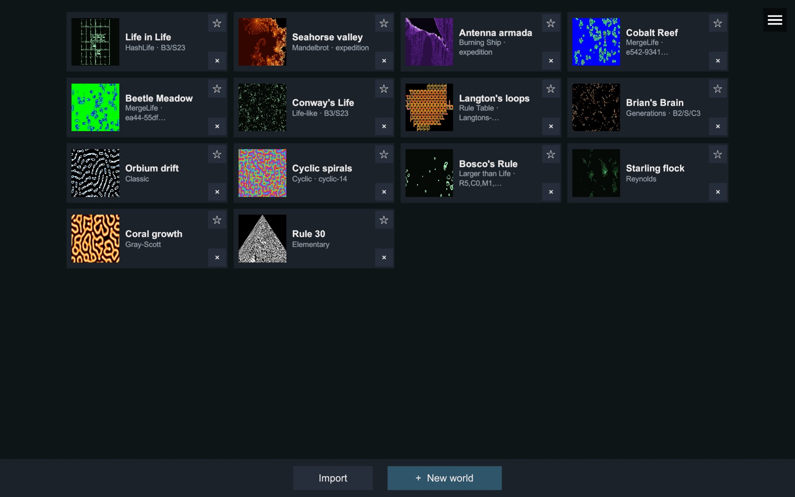

Along the bottom:

- **+ New world** — Opens the picker (see [Creating a World](#creating-a-world)).
- **Import** — Opens a file dialog to open a pattern file as a new world (see [Importing Patterns](#importing-patterns)).

The **☰** button in the top-right corner opens the **MENU**:

- **New World from Clipboard** — Makes a world from the pattern you copied last (see [Importing Patterns](#importing-patterns)).
- **Evolve MergeLife** — The rule breeder (see [Evolving MergeLife Rules](#evolving-mergelife-rules)).
- **Heaton Life Manual** — This guide.
- **About** — The app version, when it was built, and the simulation library build it is running — include these if you report a problem.
- **Interface size** — **90%**, **100%**, **115%**, or **130%**: makes every control larger or smaller. It applies at once and is remembered.
- **Keyboard Shortcuts** — See and change every shortcut (see [Keyboard Shortcuts](#keyboard-shortcuts)).

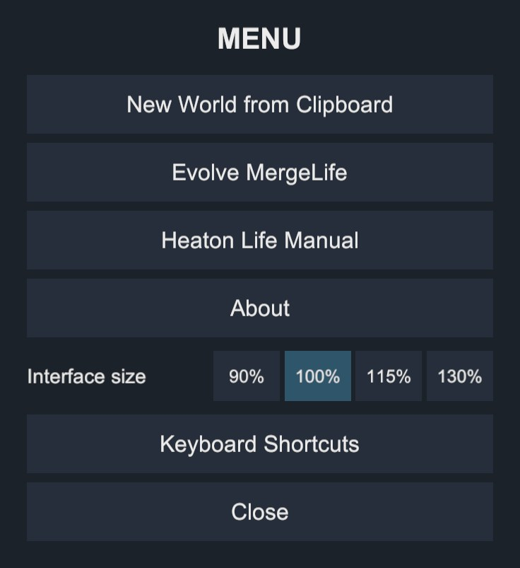

On each card, **★** marks a favorite and **×** deletes the world after a confirmation. There is no trash and no undo for a delete.

Along the top of the window (Windows) or the top of the screen (Mac) is a standard menu bar: **File**, **Edit**, **Control**, **View**, and **Help** (a Mac adds its usual **Window** menu). Nearly every command in the app is in one of them, with its shortcut beside it, and a command that can't act right now is grayed out. **About Heaton Life** is in the app menu on a Mac and at the bottom of **Help** on Windows. Hover over any toolbar button for a moment to see its name and shortcut.

## Creating a World

**+ New world** opens the picker: four categories, each card fronted by a live preview.

- **Cellular Automata** — MergeLife, Life-like, HashLife, Generations, Larger than Life, Rule Table, Elementary, Cyclic, Wireworld.
- **Continuous Fields** — Classic, Asymptotic, and Flow (the three Lenia flavors) and Gray-Scott.
- **Swarms** — Reynolds (boids).
- **Fractals** — Mandelbrot, Julia, Burning Ship, Newton (see [Fractals](#fractals)).

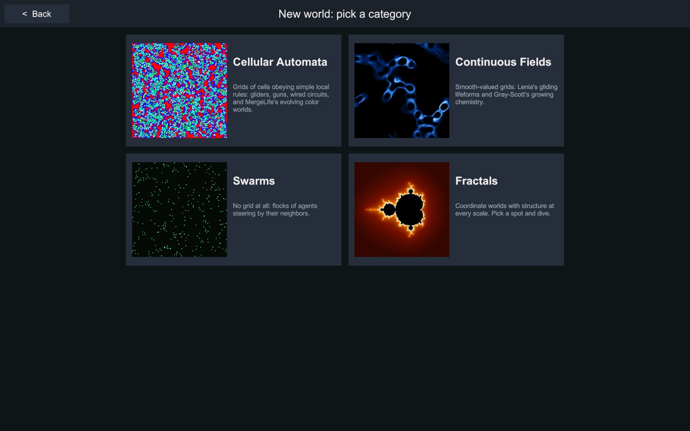

Pick a category, then a family, and the world opens. MergeLife goes one step further: its card opens the **rule gallery** — a catalog of featured rules, each running live — and you pick the rule you want to start from. Every other family starts from its default rule with a fresh random seed.

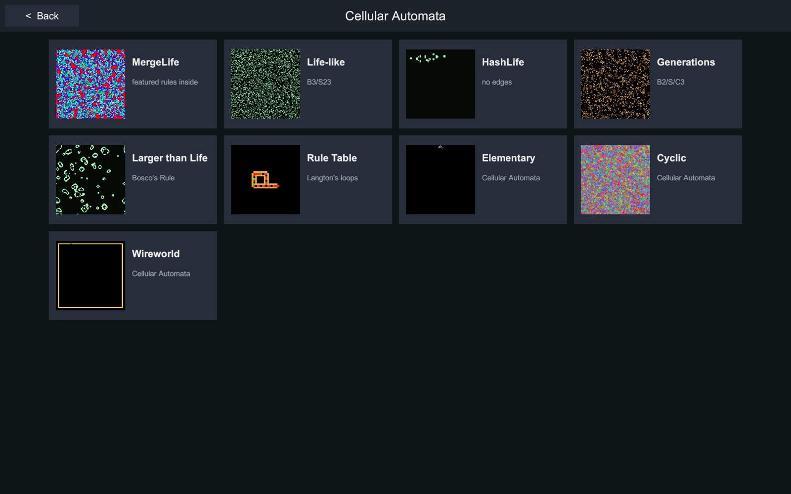

| Family | What you get |
|---|---|
| **MergeLife** | Colorful cellular automata where every rule is an eight-group hex code. Thousands of rules exist; the gallery's featured ones are a starting point, and the [evolver](#evolving-mergelife-rules) breeds new ones. |
| **Life-like** | Conway's Game of Life and its relatives — rulestrings like `B3/S23` (born with 3 neighbors, survive with 2 or 3), plus isotropic, hexagonal, von Neumann, and MAP rules and the History and Super variants (see [Life-like rules](#life-like-rules)). Presets: Conway soup, HighLife, Seeds, Day & Night, Maze, Diamoeba. |
| **HashLife** | Life on a plane with no edges, where patterns of millions of cells run and one step can leap any number of generations (see [The Unbounded World](#the-unbounded-world-hashlife)). |
| **Generations** | Life-like rules whose cells take time to die, fading through dying states: `B2/S/C3` is Brian's Brain. Presets: Brian's Brain, Star Wars, Frogs, Sticks, Fireworks, Bloomerang. |
| **Larger than Life** | Life with wide neighborhoods — a box, diamond, or circle of any range up to 500 — written like `R5,C0,M1,S34..58,B34..45,NM`. Presets: Bosco's Rule, Majority, Waffle, Globe, Diamond, Circle, Five states. |
| **Rule Table** | Any rule a `.rule` file defines, with 2 to 256 states. The presets are classics re-authored from their publications: Langton's loops, Byl's loop, the Evoloop, Langton's ant, Ant LLRR, and Ant RLR. Open any other `.rule` file to make a world of its rule. |
| **Elementary** | Wolfram's one-dimensional rules 0–255 (Rule 30, Rule 90's Sierpinski triangle, Rule 110), drawn one row per generation. |
| **Cyclic** | N states that each consume the one before them, growing spirals and demons. |
| **Wireworld** | Electrons on wires: Empty, Head, Tail, and Conductor cells. Build circuits — the zoo ships a clock and a diode. |
| **Classic / Asymptotic / Flow** | Lenia — continuous-valued Life with smooth neighborhoods, where gliding solitons and other lifeforms emerge. |
| **Gray-Scott** | Reaction-diffusion chemistry: spots, stripes, and dividing blobs from two reacting substances. |
| **Reynolds** | Boids: flocking agents with no grid at all, in two dimensions or three. |

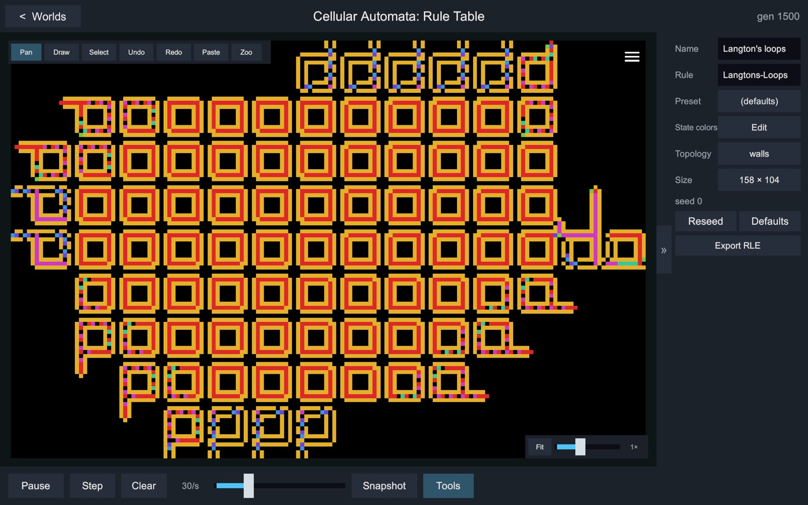

Worlds are **born saved**: the new world joins your library immediately, is saved automatically whenever you go back to the library, and is saved again when the app quits. There is no Save button. New worlds are cut to the shape of your window, so they fill the screen.

## The World Screen

A world fills the center of the screen. The **world settings** panel sits to the right (or below the canvas in a tall window), the **transport bar** runs along the bottom, the **edit bar** floats in the canvas's top-left corner, **< Worlds** in the top-left returns to the library, and the current **generation** shows in the top-right (with the **population**, the number of live cells, for Life-like worlds).

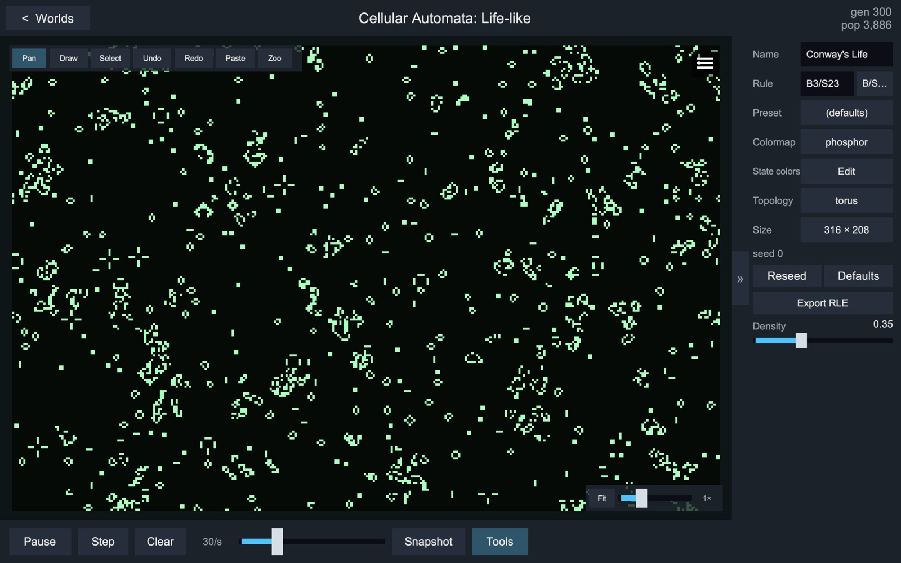

### The transport bar

- **Play / Pause** (`Space`) — Runs or pauses the world.
- **Step** (`Tab`) — Advances one step and pauses. A step is one generation unless you make it longer (see [Running a World](#running-a-world)).
- **Clear** — Empties the world and starts its generation count again at 0, paused (a MergeLife world fills with its background color). One undo step.
- **Speed** — Steps per second (the readout shows, for example, `30/s`). Slow families simply run slower than the slider asks rather than freezing. This setting is remembered across worlds.
- **Snapshot** — Saves a PNG of what's on screen (see [Snapshots](#snapshots)).
- **Tools** (`Ctrl+Alt+T / ⌥⌘T`) — Shows or hides the editing tools (the edit bar, the view controls, and the measuring readout) for full-bleed viewing. Also remembered.

### World settings

From the top, the panel holds:

- **Name** — Rename the world.
- **Rule** — For the families with typed rules (MergeLife, Life-like, Generations, Larger than Life), a text field holding the rule. Type a new rule and press Enter: a valid rule is tidied into its canonical spelling and the world starts again from its seed under the new rule (one undo step); an invalid one is refused, the status line says why, and the previous rule comes back. A Rule Table world shows its rule but keeps it — pick a preset or open a `.rule` file to get another. Elementary and Cyclic set their rules with sliders.
- **B/S…** — At the end of a Life-like world's Rule row: opens the [rule popup](#the-rule-popup).
- **Preset** — Click to cycle through the family's presets. A preset resets the world to that starting recipe; the world keeps its size and topology.
- **Colormap** — Click to cycle palettes, for families that use one. Worlds whose states have colors of their own (History and Super rules, Larger than Life rules with dying states, rule tables) don't show it.
- **State colors** — **Edit** opens a panel listing every state with its color. Pick a state and set its color with the **R**, **G**, and **B** sliders or a hex code (`#RRGGBB`); **Reset** puts back one state's color and **Reset All** every one. Your colors are saved with the world and stay over any colormap. The row reads **Edit (2 changed)** when you have changed some.
- **Far pixels** — For very large worlds: when you zoom out so far that one pixel covers many cells, **any cell** lights the pixel if any of its cells is alive, and **density** shades it by the share alive.
- **Topology** — What lies past the world's edges (Life-like, Generations, Larger than Life, Rule Table, and Wireworld). See [Topology and size](#topology-and-size).
- **Size** — The world's width and height; click to change it.
- **Reseed** — A fresh random starting state with the same rule and parameters. **Defaults** — The family's default rule and parameters (the world keeps its size and topology).
- **Export RLE** or **Export PNG ×4** — Saves the world's cells as a pattern file (see [Exporting Patterns](#exporting-patterns)).
- **Parameter sliders** — The family's own knobs: soup density, Lenia's μ and σ, Gray-Scott's feed and kill rates, the boids' count, dimensions, and steering, and so on.

Under the rows, the status line reports what your last action did.

**Folding the panel.** The tab on the panel's inner edge — **»** when it sits beside the canvas, **▼** when it sits below — folds the panel away to a thin strip so the canvas takes the room; click the tab again (**«** or **▲**) to open it. `Ctrl+I / ⌘I` does the same. The fold is remembered for every world and the next launch.

### The rule popup

**B/S…** at the end of a Life-like world's Rule row opens a card with the rule now running under its title. Choose a neighborhood — **Moore** (eight neighbors), **Hex** (six), or **von Neumann** (four) — and click the numbered chips in the **B** (birth) and **S** (survival) rows to switch counts of live neighbors on and off. Each click changes the rule at once, and as with a typed rule, a grid world starts again from its seed. A bright chip counts every arrangement of that many neighbors, a dimmer one only some (an isotropic rule split it). **Done**, `Esc`, or a click outside the card closes it.

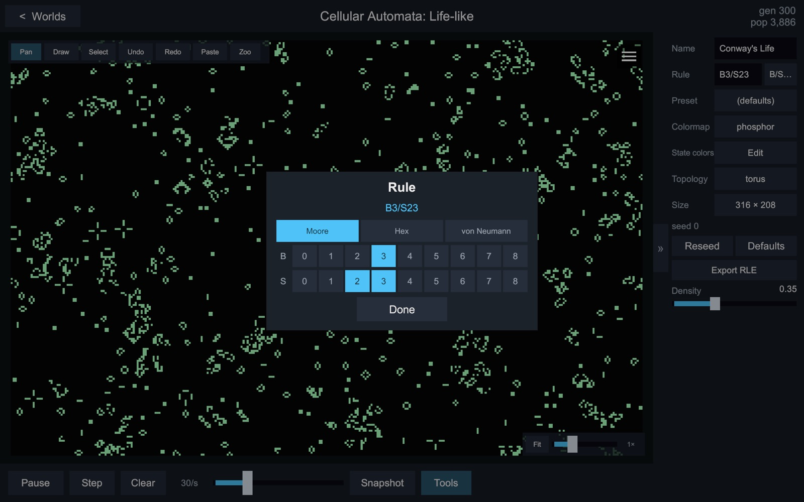

### Life-like rules

The Rule field takes every common notation for two-state rules on the 3×3 neighborhood:

- **Outer-totalistic** — `B3/S23`, `B36/S23`.
- **Isotropic** — letters after a count, such as `B2-a/S12` or `B3/S2-i34q`.
- **Hexagonal** and **von Neumann** — a trailing `H` or `V`, such as `B2/S34H`. Zoom in and the cells are drawn as hexagons or diamonds, the shapes whose touching neighbors are exactly the rule's neighbors.
- **MAP** — a `MAP` string spelling out any rule at all.
- **History** — add `History` to any rule (`B3/S23History`, or `LifeHistory`) for seven states that also record an **envelope** of every cell that has ever been alive, plus marked and boundary cells you can paint. **Track history** in the world menu (`Ctrl+Alt+Shift+H / ⌥⇧⌘H`) turns it on and off for the world as it is, keeping its cells.
- **Super** — add `Super` (`B3/S23Super`, or `LifeSuper`) for 26 states that add more marks, trails, and labels to History's.

Changing between a rule and its History or Super variant keeps the world and converts its cells. A rule can also carry a size and topology after a colon — `B3/S23:T30,20` is Life on a 30 × 20 torus.

### Topology and size

**Topology** opens a sheet (`Ctrl+Alt+W / ⌥⌘W`) with five choices: **Walls** (everything past the edges is dead), **Torus** (the edges wrap around), **Klein** (one pair of edges joins reversed), **Cross** (both pairs reversed), and **Sphere** (square worlds only). A torus or Klein bottle can also be **shifted** along the pair of edges you pick under **Edges**. The sheet says what your choice does; **Apply** changes it, keeping the cells and the generation.

**Size** opens the **World Size** sheet (`Ctrl+Alt+S / ⌥⌘S`): type a **Width** and **Height** and click one of the nine **Anchor** squares to choose where the old world sits in the new one. The sheet says how many rows and columns it adds or crops; new cells are blank. **Change Size** applies it as one undo step (Reset returns to the start in the new shape, and a recorded timeline closes).

### The world menu

The **☰** button in the canvas's top-right corner opens the **WORLD** menu of whole-world actions and settings. Each row appears only where it applies:

- **Rule lab — decode this rule** (MergeLife), **Track history** (Life-like), **Open as unbounded world**, and **Pattern info** (what the file a world came from says about its pattern).
- **Show grid lines**, **Bold grid lines** (− and +), **Show crosshair**, **Invert colors**, **Show cell icons**, and **Full screen** (see [Display options](#display-options)).
- **Select all cells** and the **Origin** row: **Set**, **Restore**, **Center** (see [Measuring](#measuring)).
- **Paste mode**, **Paste point**, whether pastes keep the world's rule or bring their own, and the **Random fill** density (see [Paste](#paste)).
- **Step**, **Step base**, **Auto fit**, **Stop if dead**, and **Set generation…** (see [Running a World](#running-a-world)).
- The **Timeline** row (**Record**, **Go to…**, **Close**) and the **Undo memory**, **Timeline memory**, and **Timeline frames** steppers (see [Undo, redo, and the timeline](#undo-redo-and-the-timeline)).
- **Reset to start position** (`Ctrl+R / ⌘R`) returns the world to its start; **Set start position = current state** (`Ctrl+Shift+R / ⇧⌘R`) makes the current state the new start.
- **Clear all cells** (`Ctrl+Del / ⌘⌫`) blanks the world, as the transport's Clear does; **Fill all cells with current ink** (`Ctrl+Shift+Del / ⇧⌘⌫`) floods it with the current ink. Both are single undo steps.

The steppers, the paste rows, **Auto fit**, and **Stop if dead** keep the menu open while you change them; the other rows close it. The same commands are in the menu bar.

## Running a World

- **Step size** — A step is the base raised to a power: **Step** (− and +, or `[` and `]`) sets the power, and **Step base** (a click cycles 2, 3, 4, 5, 8, 10, 16, 100, 1000; **Set…** or `Shift+B` types any base) the base. The default is one generation a step. A long step runs in the background with a **stepping… 45%** chip on the canvas; Pause stops it partway and the next step finishes it.
- **Stop if dead** (`K`) — Pauses the run at the first step that ends with no cell alive.
- **Auto fit** (`A`) — While the world runs, refits the view whenever a live cell leaves it.
- **Set generation…** (`Shift+G`) — Sets the generation counter, or moves it by `+n` or `-n`. No cell changes.
- **Reset** and **Set start** — See [The world menu](#the-world-menu).

## Editing Worlds

The **edit bar** in the top-left corner of the canvas holds the tools: **Pan** (`P`), **Draw** (`D`), and **Select** (`S`), plus **Undo**, **Redo**, **Paste**, and **Zoo**. `T` steps through the three tools. Every world opens with **Pan**, so a drag moves the view until you pick another tool. You can drag the bar to move it out of the way; if it's hidden, click **Tools** on the transport bar. Editing never resets the generation — a world you've drawn into is still the same world.

### Draw

Choose **Draw** and drag with the left button to paint with the current ink and brush size. Drag with the **right button** — with **Draw** or **Pan** in hand — to erase. The ink picker depends on the family:

- **Life-like, Generations, Larger than Life, Rule Table, Wireworld, Cyclic** — One swatch per state, drawn in the canvas's own colors (a rule with many states shows the first dozen; the eyedropper picks any). `,` and `.` step to the previous or next state.
- **MergeLife** — **hue** and **lum** sliders set the ink color, with **White** and **Black** shortcuts. **Background** inks the world's own background color, which is also what erasing paints.
- **Classic / Asymptotic / Flow** — A **Value** slider; each dab is a soft bump of that intensity.
- **Gray-Scott** — **Seed** or **Substrate**.
- **Reynolds** — No ink: with **Draw**, a left click scares the flock away from the pointer and a right click lures it in. **Elementary** has no painting.

Two controls are shared: **Pick** (`I`; the next click picks up the ink under the pointer — or hold **Alt / ⌥** and click) and the **size** slider.

### Select, copy, and cut

Choose **Select** and drag out a rectangle of cells. Drag a corner or edge of the selection to resize it, or **Shift**-click to extend it. Rows of actions appear in the edit bar:

- **Copy**, **Cut**, **Fill** (with the current ink), **Clear**, **Zoo +** (save the selection to the zoo), **Shrink** (to the live cells inside it), **Fit** (zoom to it), and **Deselect**.
- **CW** and **CCW** turn the selection's cells a quarter turn; **Flip H** and **Flip V** mirror them; **Outside** clears everything outside the selection; **Random** fills it with a random soup at the world menu's **Random fill** density (Life-like, Generations, and Larger than Life); **Paste In** pastes the clipboard exactly into the selection.
- **Advance** runs the selection alone one step, as if nothing else existed, and **Advance Out** runs everything outside it; the generation stays. A long advance shows its progress with a **Cancel** button.

Copy puts the pattern on Heaton Life's clipboard and, for the families whose cells are states (Life-like, Generations, Larger than Life, Rule Table, Wireworld, Cyclic), its RLE text on the system clipboard too, ready to paste into a text editor or share. `Ctrl+A / ⌘A` selects every cell and `Ctrl+Shift+A / ⇧⌘A` deselects.

### Paste

**Paste** (`Ctrl+V / ⌘V`) arms a translucent ghost of the clipboard pattern that follows the pointer. Click to stamp it — as many times as you like; a drag pans the view instead, and moving the pointer to the canvas's edge scrolls the view that way. Right-click, **Cancel**, or `Esc` puts it away. While a pattern is armed, the paste row offers:

- **The paste mode** — **Or** (the default: live cells land and the world shows through the rest), **Copy** (every cell lands, dead ones too), **Xor** (a cell under a live pattern cell flips), and **And** (a cell stays alive only under a live pattern cell). Life-like worlds offer all four; most others **Copy** and **Or**; MergeLife and Gray-Scott **Copy** only. `M` steps through them.
- **The paste point** — Which cell of the pattern you hold: **Middle**, **Top L**, **Top R**, **Btm R**, or **Btm L** (`Shift+M`).
- **CW**, **CCW**, **Flip H**, **Flip V** — Turn or mirror the pattern before you stamp it (`R`, `Shift+R`, `H`, `V`).

Paste takes Heaton Life's own clipboard first; if that is empty, it reads the system clipboard as RLE text. So a pattern copied straight from LifeWiki pastes right in. Two rules apply:

- **Patterns never cross families.** A Life glider cannot be pasted into Wireworld; the status line explains the refusal and names the pattern's home family.
- **Patterns may cross rules within a family** — and the ghost turns amber with a ⚠ note naming the rule the pattern is native to. The paste is always allowed; **Use Its Rule** beside the note switches the world to the pattern's rule (Life-like and MergeLife), keeping its cells. Click the world menu's **Pastes keep this world's rule** row to make it **Pastes bring their own rule**, and every paste does that.

### The zoo

**Zoo** (`Z`) slides open the family's pattern library: built-in patterns (for Life, spaceships, oscillators, still lifes, methuselahs, and the Gosper glider gun; HighLife's replicator; Wireworld's clock and diode) plus every selection you've saved, marked "yours". Patterns native to the world's rule come first; patterns from other rules are listed under **Other rules — may not survive here**. Each card shows a thumbnail, the name, and the rule and size the pattern was captured under. Click a card to arm it for pasting. **×** deletes your own entries (built-ins stay). **Save selection to zoo** at the top captures the current selection. The zoo only ever shows patterns that belong to the current family.

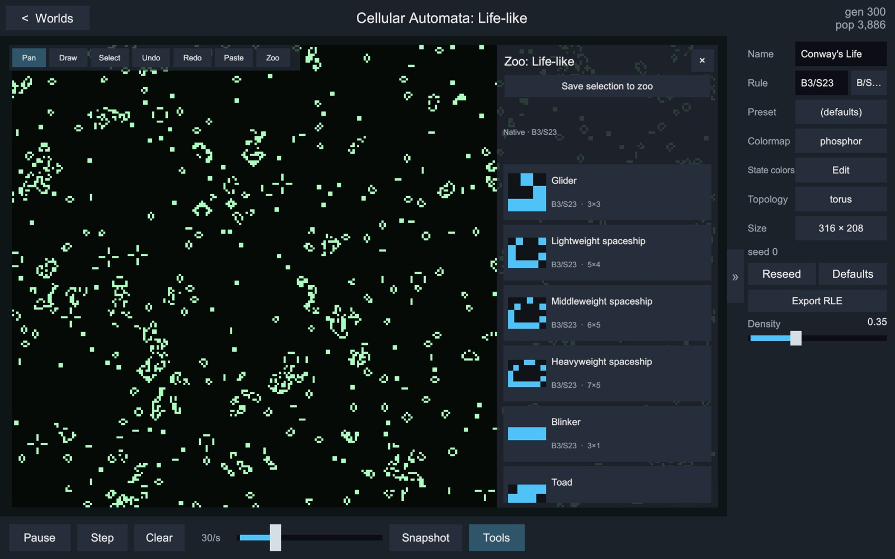

### Undo, redo, and the timeline

**Undo** (`Ctrl+Z / ⌘Z`) and **Redo** (`Ctrl+Y / ⇧⌘Z`) step back and forward through everything you've done to the world: brush strokes, stamps, fills, clears, cuts, turns, rule and setting changes, resets, selections — and runs, where everything from Play to Pause is one step. The status line says what each one undid. How far back you can go is set by memory, not a count: **Undo memory** in the world menu (512 MB unless you change it). A change too big for it still happens, and the status line says it can't be undone.

**The timeline** records the world as it runs. Choose **Record** in the world menu's Timeline row (`Ctrl+Shift+T / ⇧⌘T`) and every step keeps a frame. A bar docks above the transport: **Rec**, **|<** and **>|** (first and last frame), **<<** and **>>** (play backward and forward, `J` and `L`), **<** and **>** (one frame, `←` and `→`), a scrubber, a readout such as `frame 37 of 120 · gen 37`, and **Close**.

- Moving to a frame shows the world as it was, paused. **Step** then shows the next frame, and **Play** plays the recording and runs on past its end.
- Editing the world while it shows an earlier frame cuts off the frames after it, and recording goes on from there.
- **Go to…** (`Ctrl+J / ⌘J`) jumps to a frame number. **Close** (`Ctrl+Alt+Shift+T / ⌥⇧⌘T`) discards the frames and leaves the world where it is.
- A timeline keeps 1,000 frames and up to 1 GB unless you change **Timeline frames** or **Timeline memory**; past that the oldest frames go.

### Zooming and panning the grid

Navigation works the same way on every canvas in the app:

- **Scroll** (a mouse wheel, or two fingers up and down a trackpad) zooms in and out around the pointer, whatever tool is active.
- **`Ctrl`+scroll / `⌘`+scroll** pans in any direction, and so does dragging with the **middle mouse button** — handy while you're drawing. With the **Pan** tool, a left drag pans.
- `Ctrl+= / ⌘=` and `Ctrl+- / ⌘-` zoom in and out; `Ctrl+0 / ⌘0` fits the whole world.
- The **view controls** in the canvas's bottom-right corner hold **Fit** and a zoom slider with its readout.

You can zoom out until each cell is a single screen pixel (a large world then sits small in the middle of the canvas) and in to 32× — further on very large worlds. You can pan a little past the grid's edge, so cells sitting under the floating toolbar can always be pulled out from beneath it.

### Measuring

- **The readout** in the canvas's bottom-left corner names the cell under the pointer, counted from the origin, and its state (`(12, -3) · live`), and while you select, the selection's size and how many of its cells are alive (`12 × 7 · 31 live`).
- **The origin** — The cell that reads 0, 0. **Set** in the world menu's Origin row makes the next cell you click the origin (`Shift+O` takes the cell under the pointer); **Restore** (`Ctrl+Alt+O / ⌥⌘O`) puts back the world's own; **Center** (`O`) centers the view on it.
- **The crosshair** (`X`) reads the center of the canvas instead of the pointer.
- **Grid lines** appear as you zoom in (`G` turns them off and on), with **bold lines** every 10 cells from the origin; **Bold grid lines** − and + (`Ctrl+[ / ⌘[` and `Ctrl+] / ⌘]`) change the spacing or turn them off.

### Display options

- **Invert colors** (`Shift+I`) — Shows every color as its opposite: light lines on a dark world become dark on light. Snapshots and exports keep the world's own colors.
- **Cell icons** (`Shift+C`) — Draws a two-state Life-like world's live cells as round dots when you zoom in.
- **State colors** (`Ctrl+Shift+C / ⇧⌘C`) — The colors panel described under [World settings](#world-settings).
- **Full screen** (`F11 / ⇧⌘F`) — The world alone on the screen; the world keeps running, and the keyboard and menus still work. **Exit Full Screen** in the corner, the same shortcut, or `Esc` brings everything back.

## The Unbounded World (HashLife)

The **HashLife** card on the Cellular Automata page opens an unbounded world: Life on a plane with no edges. Patterns of millions of cells run here, and one step can leap any number of generations. A new one starts with the Gosper glider gun; **Preset** cycles through it, the R-pentomino, Acorn, and HighLife's replicator. Giant pattern files open here too (see [Importing Patterns](#importing-patterns)).

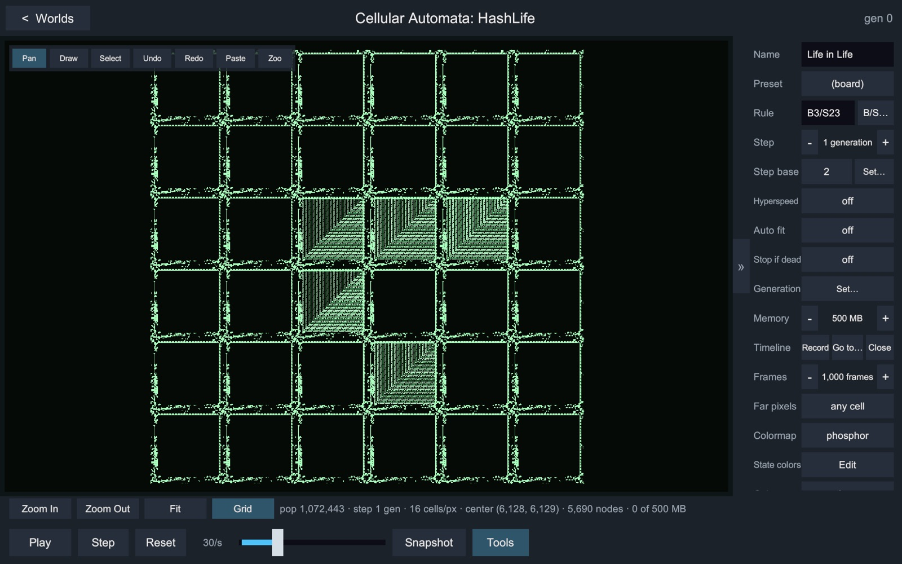

The screen works like a grid world's — the same edit bar, zoo, selection, paste, undo, and timeline — with these differences:

- **The transport bar** holds **Play / Pause**, **Step**, **Reset** (back to the world as it was born, opened from a file, or last given a preset), the speed slider, **Snapshot**, and **Tools**.
- **The status strip** under the canvas holds **Zoom In**, **Zoom Out**, **Fit**, and **Grid**, and a readout of the population, the step, the scale (`16 cells/px` zoomed out, `4 px/cell` zoomed in), the center cell, and the memory in use.
- **Navigation** is the same as on a grid, a zoom step being a doubling. Positions stay exact however far you travel.
- **Lost?** When nothing alive is in view, a card in the middle of the canvas says so, gives the scale, points an arrow toward the pattern, says how many cells away it is, and offers **Fit** to bring it back.
- **Drawing** needs you to zoom in until a cell is at least a pixel. While **Draw** is in hand, an **Ink** row shows a swatch for every state, dead first; right-click erases. Selecting works at any zoom. Edits reach a billion cells from the origin in every direction; **Copy** and **Random** fill are limited to about 16 million cells, while **Clear**, the turns and flips, and **Advance** work on any rectangle.

The settings panel (with the same fold tab) holds, from the top:

- **Name**, **Preset**, and **Rule** — The Rule field takes any Life-like rule, `B0` rules included, and on a two-state world **B/S…** opens the rule popup. A rule change keeps the cells. Under a rule with `B0`, the cells shown are the ones that differ from a living background, and the readout says `pop all but …`.
- **Step**, **Step base**, **Hyperspeed**, **Auto fit**, **Stop if dead**, **Generation** — As on a grid world, except that a step can be as long as 2^509 generations. **Hyperspeed** (`U`) lengthens the step by one power each time a full base of steps has gone by quickly, as far as the memory budget allows.
- **Memory** — How much memory the world may use, from 64 MB to 8000 MB (500 MB to start). More memory makes big patterns faster; it never changes the results. Half of what the world leaves free holds its undo steps and timeline.
- **Timeline** and **Frames** — Record, go to, or close a timeline, and how many frames it keeps.
- **Far pixels**, **Colormap**, **State colors**, **Colors** (invert), **Cell icons**, **Full screen**, **Grid lines**, **Bold grid**, **Crosshair**, **Origin**.
- **Paste mode**, **Paste point**, **Paste rule**, **Random fill**.
- **Reset** and **Snapshot**; **Export RLE** and **Export .mc**; **Pattern info**.
- **Grid world** — **Open** makes a new grid world around the live cells (`Ctrl+Alt+G / ⌥⌘G`). The other way, **Open as unbounded world** in a Life-like, Generations, Rule Table, or Wireworld world's menu (`Ctrl+Alt+B / ⌥⌘B`) puts its cells, rule, and generation on a new unbounded plane. Either way the world you started from stays in your library as it was.

**Many states.** The plane also runs History and Super rules — type one into the Rule field and the world converts, cells and all — plus Generations rules, rule tables, and Wireworld, which arrive from files or from a grid world. Each world's rule changes only within its family.

## The Rule Lab

For a MergeLife world, **☰ > Rule lab — decode this rule** (`Ctrl+L / ⌘L`) opens a table of what the rule code actually says: each of the eight groups decoded into its α, range, key color, β, and γ values beside the raw octets. It is the same decoding the research paper describes, useful for understanding why a rule behaves as it does — or for reading a rule the evolver bred.

## Importing Patterns

Heaton Life reads the pattern formats used across the Life community (for example, patterns downloaded from LifeWiki), recognizing each by its content rather than its file name, and opens each as a world of the right family:

| Format | File endings | Opens as |
|---|---|---|
| RLE | `.rle`, `.txt` | A world of its rule's family: Life-like (History and Super too), Generations, Larger than Life, Rule Table, or Wireworld |
| Macrocell | `.mc`, `.mc.gz` | An unbounded world, with its timeline if it has one |
| Plaintext | `.cells` | Life-like |
| Life 1.05 and 1.06 | `.lif`, `.life` | Life-like (or Generations, under a Generations rule) |
| MCell | `.mcl` | Life-like, Generations, or Larger than Life |
| Rule file | `.rule` | A Rule Table world of that rule |
| PNG | `.png` | A MergeLife world, for a PNG exported from one; otherwise a picture of a pattern (white is dead, any other color alive) |
| BMP | `.bmp` | A picture of a pattern |
| gzip | `.gz` | Whatever it holds |
| zip | `.zip` | A list of the pattern files inside; pick one |

The ways in:

1. **File > Import…** (`Ctrl+O / ⌘O`) or the **Import** button on the worlds library — Choose a file. A pattern opens centered on a comfortable grid, under the rule its file names (`B3/S23` when it names none).
2. **File > Open Recent** — The last ten pattern files you opened or saved. **Clear Menu** empties the list.
3. **Drop a pattern file on the window.**
4. **File > New World from Clipboard** (`Ctrl+Shift+O / ⇧⌘O`, also in the MENU) — Makes a world from whatever you copied last: a selection you copied in Heaton Life, or pattern text from anywhere — a LifeWiki page, a forum post, a `.rule` file's text.
5. **Paste inside a world** — Copy a pattern's RLE text anywhere, then use the edit bar's **Paste** tool in a matching world to stamp it wherever you like.

**Very large patterns.** A pattern more than 2,048 cells across, under a rule HashLife runs, asks whether to open it in HashLife or as a grid world. One too large for any grid (more than about 64 million cells) can only open in HashLife, so the question offers **Open in HashLife** or **Don't Open**.

**Pattern info.** A file's name, author, and comments stay with its world: **Pattern info** in the world menu (`Ctrl+Shift+I / ⇧⌘I`) shows them, and exports write them back.

## Exporting Patterns

- **Export RLE…** (`Ctrl+E / ⌘E`) — Life-like, Generations, Larger than Life, Rule Table, Wireworld, Cyclic, and unbounded worlds. It writes the rectangle the live cells cover, named after the world; from a world whose edges aren't walls it writes the whole grid with its topology, so it reopens as the same world. A rule table outside the starter set travels with the pattern.
- **Export Macrocell…** (`Ctrl+Shift+M / ⇧⌘M`) — Unbounded worlds of any size, with the timeline if one is recorded.
- **Export PNG ×4** (`Ctrl+Shift+P / ⇧⌘P`) — A MergeLife world's lattice as a PNG at four times its size, which can be imported again as a world.

RLE and Macrocell exports open a save dialog: on a Mac, **Compress with gzip** adds `.gz`; on Windows, choose the gzipped file type. PNG exports go to the Snapshots folder.

## Snapshots

**Snapshot** on the transport bar (or on a fractal's status bar), or **File > Save Snapshot** (`Ctrl+Shift+S / ⇧⌘S`), saves a PNG of the current view, named `heatonlife-<family>-<date>-<time>.png`; the status line confirms with `saved …`, and the desktop app then shows you the file — selected in a Finder window on macOS, in Explorer on Windows. Snapshots go to the app's **Snapshots** folder:

- **Windows:** `%USERPROFILE%\AppData\LocalLow\Jeff Heaton\Heaton Life\Snapshots`
- **macOS (App Store version):** inside the app's container, `~/Library/Containers/com.heatonresearch.heatonlife/Data/Library/Application Support/com.heatonresearch.heatonlife/Snapshots` — the app opens a Finder window on the file for you, so you rarely need the path (to browse there by hand, hold **Option** in Finder and choose **Go > Library**).

Your worlds library and pattern zoo live beside that folder. Everything stays on your computer.

## Fractals

Fractals are the picker's fourth category. Each one you open is an **expedition** — a viewpoint into the set that is saved in your library like any world, with its own thumbnail. Four sets are available, each with presets: **Mandelbrot** (Home, Seahorse valley), **Julia** (Classic, Douady rabbit, Dendrite), **Burning Ship** (Full ship, Antenna armada), and **Newton** (z³ − 1, z⁵ − 1).

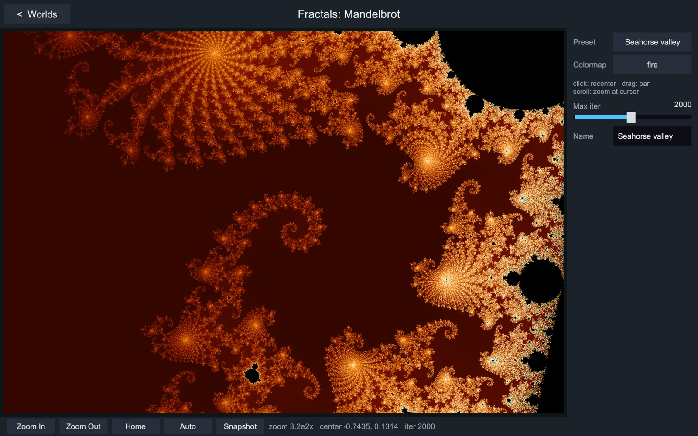

Navigation is map-style:

- **Click** to recenter on a point — a crosshair marks the new center until the frame arrives.
- **Drag** to pan; **`Ctrl`+scroll / `⌘`+scroll** pans too.
- **Scroll** to zoom in and out around the pointer.
- **Zoom In** and **Zoom Out** zoom at the center; **Home** returns to the set's home view.
- **Auto** starts a hands-free dive: the view drifts toward the nearest interesting boundary and zooms continuously, sharpening to full resolution the moment it stops. The button becomes **Stop**; any click, drag, or scroll also stops it, and the dive ends by itself at the maximum zoom.

The status line reads out the current zoom and center, for example `zoom 1.0e5x   center -0.745, 0.112`. Zoom goes to 10¹² — a trillion times — with the center tracked precisely enough that the image never smears at depth. Deep frames take longer: a **rendering…** chip shows the percentage done, with a **Cancel** button that abandons the frame and returns the iteration budget to its automatic setting.

In the settings panel: **Preset**, **Colormap**, **Max iter** (the iteration budget), and **Name**, which renames the expedition. Heaton Life raises the budget automatically as you go deeper; once you move the slider by hand it stays where you put it, which is the usual reason a frame takes forever — Cancel resets it. Julia worlds add the constant **c (re)** and **c (im)**; Newton adds the polynomial **Degree** and uses its iteration slider directly.

## Evolving MergeLife Rules

**MENU > Evolve MergeLife** on the library screen opens the evolver: a genetic algorithm that breeds MergeLife rules and scores each one by how interesting its world stays over time, the way the original MergeLife research trainer did. Nothing here creates a world until you ask.

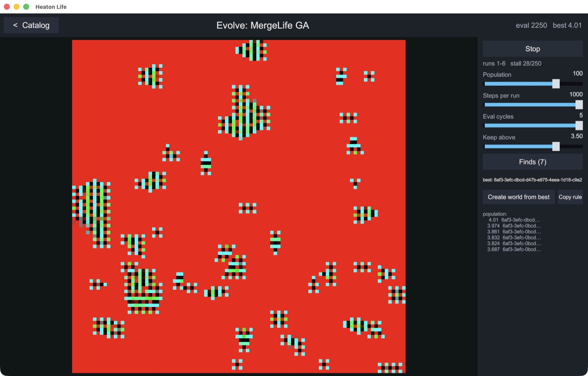

- **Start / Stop** — Starts a search with a fresh random population (and a fresh random seed each time). Stop ends it. The search keeps running while you switch to other windows, and only leaving the evolve screen with **< Catalog** stops it.
- **Population** (16–128, default 100), **Steps per run** (100–1000), and **Eval cycles** (1–5) — The search's size and patience; the defaults are the reference trainer's.
- **Keep above** — The score a rule must reach to be kept as a find. Scores run up to 5.0; the gallery's featured rules score between about 1.8 and 4.8, and the default of 3.5 is the historical "worth saving" bar. Raising it later never throws away what's already logged.

The big preview runs the current best rule live, and the leaderboard lists the population's top scores. A search runs in **restarts**: a population eventually stalls, so after 250 evaluations without a new best (the `run 7` `stall 120/250` line under Start) the run is discarded and a fresh one begins, automatically, until you stop. On machines with many cores several runs breed at once (`runs 12-17`). Each run's champion is what gets kept.

- **Create world from best** — Opens the current best rule as a new, saved world in your library. **Copy rule** — Puts its rule code on the clipboard, ready to paste into any MergeLife world's **Rule** field.
- **Finds** — The catalog of every kept rule, best score first, each card running a live preview. The title announces new arrivals (`+3 new`); **Refresh** brings them in without shuffling the cards you're reading, **Clear** empties the log, and **×** removes one find. Click a card to open the rule as a **preview world** — the search keeps breeding underneath — and decide with the bar at the top of the canvas: **Create as World** (`Ctrl+S / ⌘S`) keeps it in your library; **Delete World** (or **< Evolve**) discards it. Finds persist between launches, so a long search only ever improves the catalog.

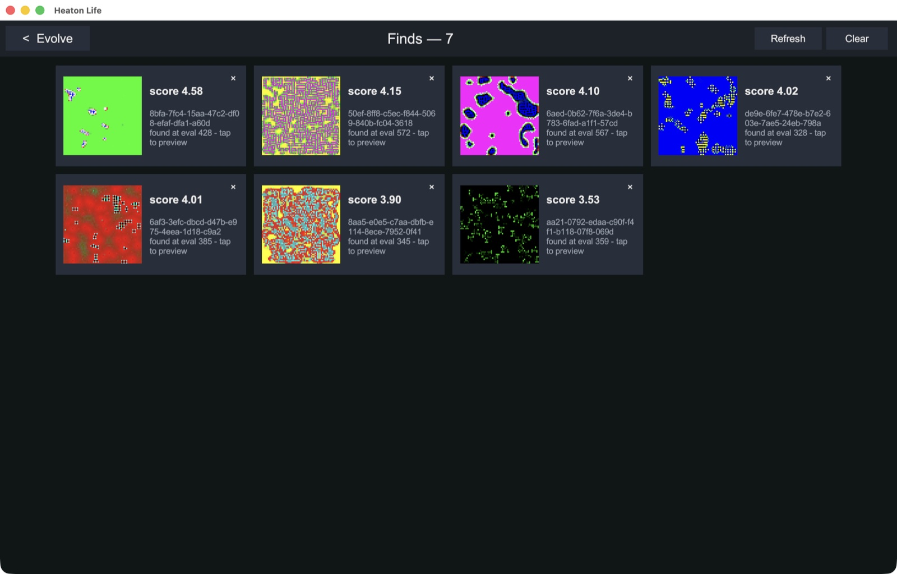

## Keyboard Shortcuts

**Help > Keyboard Shortcuts…** (`Ctrl+/ / ⌘/`, also in the MENU) lists every command under its menu with its shortcut. To change one, click its shortcut and press the new keys (`Esc` cancels); **Clear** leaves a command without one, **Default** puts back the one it came with, and **Restore Defaults** resets them all. A shortcut the system needs is refused, and taking one another command holds asks first. Your choices show in the menus at once.

Some of the shortcuts the app comes with:

| Command | Windows / Mac |
|---|---|
| Play / Pause, Step | `Space`, `Tab` |
| Pan, Draw, Select, next tool | `P`, `D`, `S`, `T` |
| Undo, Redo | `Ctrl+Z / ⌘Z`, `Ctrl+Y / ⇧⌘Z` |
| Cut, Copy, Paste, Paste to Selection | `Ctrl+X / ⌘X`, `Ctrl+C / ⌘C`, `Ctrl+V / ⌘V`, `Ctrl+Shift+V / ⇧⌘V` |
| Clear, Fill with Ink (the selection) | `Del / ⌫`, `Shift+Del / ⇧⌫` |
| Clear Outside, Random Fill | `Alt+Del / ⌥⌫`, `Alt+Shift+Del / ⌥⇧⌫` |
| Rotate clockwise and counter-clockwise, flip | `R`, `Shift+R`, `H`, `V` |
| Advance Selection, Advance Outside | `N`, `Alt+N / ⌥N` |
| Pattern Zoo, Add Selection to Zoo | `Z`, `Shift+Z` |
| Zoom In, Zoom Out, Fit, Fit Selection | `Ctrl+= / ⌘=`, `Ctrl+- / ⌘-`, `Ctrl+0 / ⌘0`, `Ctrl+Alt+0 / ⇧⌘0` |
| Grid Lines, Crosshair, Auto Fit | `G`, `X`, `A` |
| Smaller and Larger Step, Next Step Base | `[`, `]`, `B` |
| Reset to Start, Set Start to Current State | `Ctrl+R / ⌘R`, `Ctrl+Shift+R / ⇧⌘R` |
| Next Preset, Next Colormap, Reseed | `Ctrl+Alt+P / ⌥⌘P`, `C`, `Ctrl+Alt+R / ⌥⌘R` |
| Record Timeline, previous and next frame | `Ctrl+Shift+T / ⇧⌘T`, `←`, `→` |
| Edit Tools, World Settings | `Ctrl+Alt+T / ⌥⌘T`, `Ctrl+I / ⌘I` |
| Import, Close World | `Ctrl+O / ⌘O`, `Ctrl+W / ⌘W` |

## Tips & Troubleshooting

- **"Paste rejected"** — Patterns belong to a family. A Life pattern pastes into Life-like worlds only; check the status line for the reason and the pattern's home family.
- **A pasted pattern dies immediately** — It was captured under a different rule (the amber ⚠ ghost warned you). Same family, different physics. Click **Use Its Rule** to run the world under the pattern's rule.
- **Scrolling zooms instead of panning** — That's by design. Hold `Ctrl` or `⌘` while you scroll, drag with the middle mouse button, or use the **Pan** tool.
- **I'm lost on the unbounded plane** — Click **Fit** on the card that appears, or on the status strip.
- **A file is too large to open** — Open it in HashLife when the app offers: the unbounded world holds patterns far too big for any grid.
- **A fractal frame never finishes** — Click **Cancel** on the rendering chip; it also resets a hand-cranked **Max iter** to automatic.
- **Worlds open with black bars** — Older worlds keep the size they were born with. Click **Fit**, or change the world's **Size**.
- **"Not undoable"** — The change was bigger than the undo memory. Raise **Undo memory** in the world menu.
- **The evolver is slow** — Each evaluation runs a world for up to **Steps per run** generations, **Eval cycles** times. Lower either for a faster (rougher) search.
- **Where is everything stored?** — In the app's data folder beside [Snapshots](#snapshots): `catalog` (worlds and expeditions), `zoo` (your patterns), and the evolver's finds. Nothing is sent over the internet.
- **Getting help** — **Help > Heaton Life Manual** opens this guide. **About Heaton Life** shows the version, build time, and library build to include in a report.

---

*Heaton Life is provided under the Apache 2.0 License. MergeLife is described in Jeff Heaton's 2017 paper, "Evolving Continuous Cellular Automata for Aesthetic Objectives" (arXiv:1809.00656).*
