# Heaton Life User Guide — iPhone, iPad & Android

Heaton Life is an app for exploring **emergence** — simple rules that grow complex, organic-looking behavior. It brings the classic systems of artificial life together in one place: cellular automata (MergeLife, Conway-style Life and its many relatives, Generations, Larger than Life, rule tables such as Langton's loops, Elementary, Cyclic, Wireworld), an unbounded HashLife plane for patterns of millions of cells, three flavors of Lenia, Gray-Scott reaction-diffusion, flocking boids, and deep-zoom fractals (Mandelbrot, Julia, Burning Ship, Newton). Create worlds, paint and edit them with pattern tools, open pattern files in all the common formats, breed brand-new MergeLife rules with the built-in evolver, and keep everything in your worlds library.

Everything runs and stays on your device — nothing is uploaded anywhere (see the [privacy policy](privacy.md)).

There is a separate guide for [Windows and macOS](manual-app.md).

---

## Families, Rules, and Worlds

- A **family** is a form of physics — MergeLife, Life-like, Generations, Wireworld, Classic Lenia, and so on. Each family is one tile in the New-world picker.
- A **rule** is the set of constants inside a family: a Life-like rulestring such as `B3/S23`, a Generations rule such as `B2/S/C3`, a MergeLife rule code, a Cyclic state count. The same family with a different rule is a parallel universe — a pattern moved between rules usually dies within a step, and finding the ones that survive is half the fun.
- A **world** is one live instance of a rule: its parameters, its starting seed, its current state, and its generation. It stays the same world through running, pausing, editing, and reloading.

Families of rules create worlds. A world's family is fixed for its lifetime; the rule can change inside it.

## Getting Started

When you open Heaton Life, you'll see your **worlds library** — a card for every world you've created, each with a live thumbnail, its name, and its family, rule, and generation. The first time you launch the app this screen says **No worlds yet**.

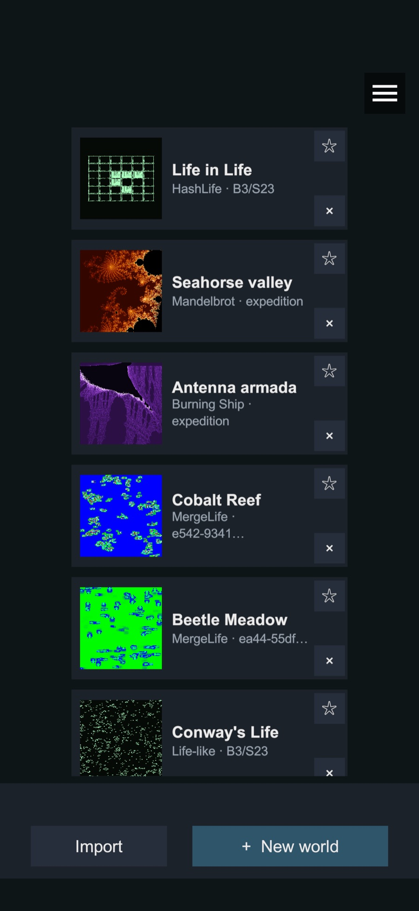

- **+ New world** — Opens the picker (next section).
- **Import** — Opens your device's file picker to open a pattern file as a new world (see [Importing Patterns](#importing-patterns)).
- The **☰** button opens the **MENU**: **New World from Clipboard** (a world from the pattern you copied last), **Evolve MergeLife**, this **Heaton Life Manual**, and the **About** screen (version, build time, and the simulation library build the app is running — include these if you report a problem).

On each card, **★** marks a favorite and **×** deletes the world after a confirmation. There is no undo for a delete.

## Creating a World

**+ New world** opens the picker: four categories, each card fronted by a live preview — **Cellular Automata** (MergeLife, Life-like, HashLife, Generations, Larger than Life, Rule Table, Elementary, Cyclic, Wireworld), **Continuous Fields** (Classic, Asymptotic, and Flow Lenia, plus Gray-Scott), **Swarms** (Reynolds boids), and **Fractals** (Mandelbrot, Julia, Burning Ship, Newton). Tap a category, then a family. MergeLife goes one step further: its card opens the **rule gallery** of featured rules, each running live, and you pick the one to start from.

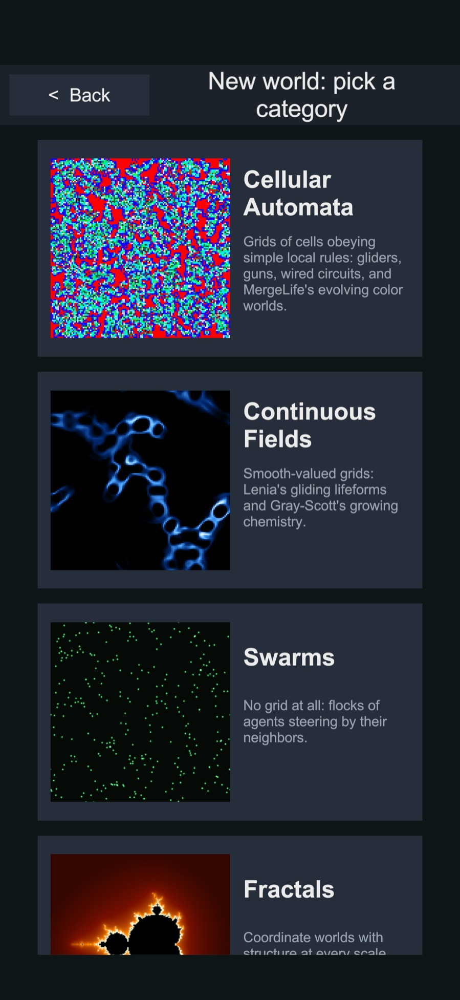 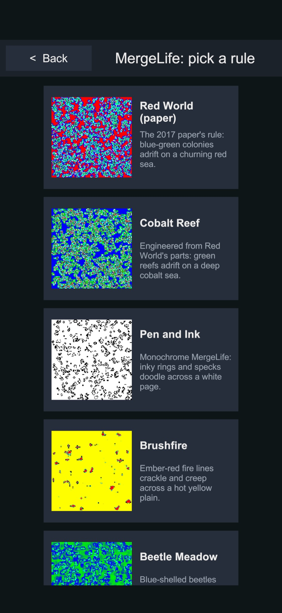

| Family | What you get |
|---|---|
| **MergeLife** | Colorful cellular automata where every rule is a hex code; the gallery's featured rules are a starting point, and the [evolver](#evolving-mergelife-rules) breeds new ones. |
| **Life-like** | Conway's Game of Life and its relatives — `B3/S23` and every common notation: isotropic, hexagonal, von Neumann, MAP, and the History and Super variants. |
| **HashLife** | Life on a plane with no edges, for huge patterns and giant leaps in time (see [The Unbounded World](#the-unbounded-world-hashlife)). |
| **Generations** | Life-like rules whose cells fade through dying states — `B2/S/C3` is Brian's Brain. |
| **Larger than Life** | Life with wide neighborhoods, written like `R5,C0,M1,S34..58,B34..45,NM` — Bosco's Rule and more. |
| **Rule Table** | Any rule a `.rule` file defines — Langton's loops, Byl's loop, the Evoloop, Langton's ant and more come built in. |
| **Elementary** | Wolfram's one-dimensional rules 0–255, drawn one row per generation. |
| **Cyclic** | N states that each consume the one before them — spirals and demons. |
| **Wireworld** | Electrons on wires: Empty, Head, Tail, and Conductor cells. |
| **Classic / Asymptotic / Flow** | Lenia — continuous Life with gliding lifeforms. |
| **Gray-Scott** | Reaction-diffusion chemistry: spots, stripes, dividing blobs. |
| **Reynolds** | Boids — flocking agents with no grid at all, in two dimensions or three. |

Worlds are **born saved**: a new world joins your library immediately, is saved whenever you go back, and again when you leave the app. There is no Save button. New worlds are cut to the shape of your screen, so a phone world is tall and a tablet world matches its orientation.

## The World Screen

### On a phone

The world fills the screen from the top bar to the transport bar. **< Worlds** in the top-left returns to the library; the generation shows in the top-right (with the population, the number of live cells, for Life-like worlds).

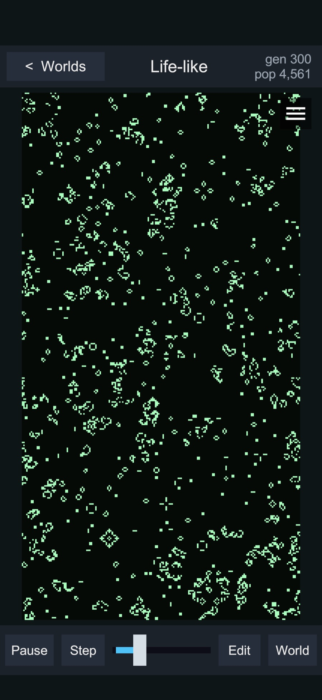 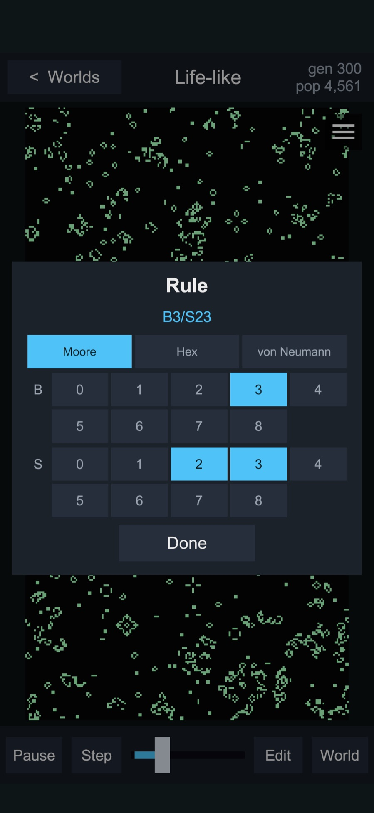

The transport bar holds **Play / Pause**, **Step**, the **speed** slider (steps per second), **Edit**, and **World**:

- **Edit** shows and hides the editing tools: the edit strip across the top of the canvas, the view controls (**Fit** and a zoom slider) above the transport, and the measuring readout. Phones open every world in viewing mode, so the canvas is clear until you ask for the tools.
- **World** opens the world's **Settings** page; **Done** at its top-right returns to the canvas.

The Settings page holds, from the top:

- **Name** — Rename the world.
- **Rule** — For MergeLife, Life-like, Generations, and Larger than Life. Type a rule and tap Done on the keyboard: a valid rule is tidied into its canonical spelling and the world starts again from its seed under it; an invalid one is refused, a message says why, and the old rule comes back. A Rule Table world shows its rule but keeps it — pick a preset or open a `.rule` file to get another.
- **B/S…** — At the end of a Life-like world's Rule row. It opens the **rule popup**: choose a neighborhood (**Moore**, **Hex**, or **von Neumann**) and tap the numbered chips in the **B** (birth) and **S** (survival) rows to change the rule at once (the world starts again from its seed, as with a typed rule). A bright chip counts every arrangement of that many neighbors, a dimmer one only some. **Done** closes it.
- **Preset** and **Colormap** — Tap to cycle. A preset restarts the world from that recipe, keeping its size and topology.
- **State colors** — **Edit** opens a panel where you can give any state a color of your own (R, G, B sliders or a hex code; **Reset** and **Reset All** put the originals back).
- **Topology** — What lies past the edges, for Life-like, Generations, Larger than Life, Rule Table, and Wireworld: **Walls**, **Torus** (wrap around), **Klein** bottle, **Cross**-surface, or **Sphere** (square worlds), and for a torus or Klein bottle a shift along one pair of edges. **Apply** keeps the cells.
- **Size** — Tap to change the world's **Width** and **Height**; one of the nine **Anchor** squares says where the old world sits in the new one. **Change Size** applies it.
- **Reseed** (a fresh random start with the same rule) and **Defaults** (the family's defaults, keeping the size and topology).
- **Export RLE** or **Export PNG ×4** (see [Exporting Patterns](#exporting-patterns)), and the family's parameter sliders.

The **☰** menu on the canvas holds whole-world actions and settings, each where it applies: **Rule lab — decode this rule** (MergeLife), **Track history** (Life-like), **Open as unbounded world**, **Pattern info**, **Show grid lines**, **Bold grid lines**, **Show crosshair**, **Invert colors**, **Show cell icons**, **Full screen**, **Select all cells**, the **Origin** row (**Set**, **Restore**, **Center**), **Paste mode**, **Paste point**, the paste rule, **Random fill**, **Step**, **Step base**, **Auto fit**, **Stop if dead**, **Set generation…**, the **Timeline** row, the **Undo memory**, **Timeline memory**, and **Timeline frames** steppers, **Reset to start position**, **Set start position = current state**, **Clear all cells**, **Fill all cells with current ink**, and **Save snapshot (PNG)**. These are explained in the sections below.

### On an iPad or Android tablet

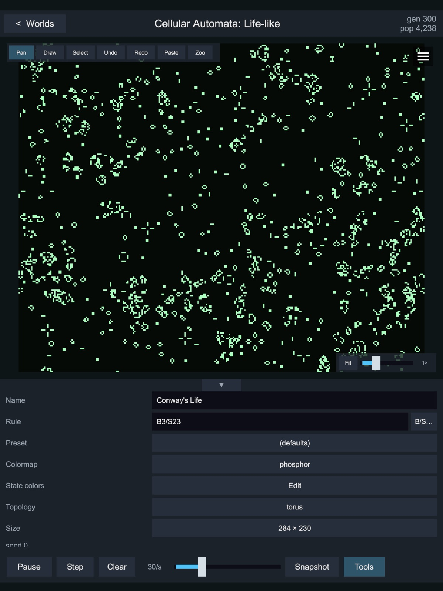

A tablet uses the larger layout: the settings panel (the same rows as a phone's Settings page) sits beside the canvas in landscape and below it in portrait, the transport bar carries **Play / Pause**, **Step**, **Clear**, **Speed**, **Snapshot**, and **Tools** (show or hide the editing tools), and the edit bar floats over the canvas, where you can drag it out of the way. **Clear** empties the world and starts its generation count again at 0 (a MergeLife world fills with its background color).

The tab on the settings panel's inner edge — **»** beside the canvas, **▼** below it — folds the panel away to a thin strip so the canvas takes the room; tap it again to open the panel. The fold is remembered for every world.

### Life-like rules

Besides `B3/S23`, the Rule field takes isotropic rules (`B2-a/S12`), hexagonal and von Neumann rules (a trailing `H` or `V`, drawn as hexagons or diamonds when you zoom in), and `MAP` strings. Add `History` to a rule (`B3/S23History`, or `LifeHistory`) for seven states that record an envelope of every cell that has ever been alive — **Track history** in the ☰ menu turns it on and off for the world as it is — or `Super` (`LifeSuper`) for 26. Changing between a rule and its History or Super variant keeps the world's cells.

### Running a world

- **Step** in the ☰ menu (− and +) makes each step longer: the **Step base** (2 unless you tap it to cycle, or **Set…** to type one) raised to a power. A long step shows a **stepping…** chip with its progress.
- **Stop if dead** pauses the run when no cell is left alive; **Auto fit** keeps the pattern in view as it grows; **Set generation…** sets the counter.
- **Reset to start position** returns to the start; **Set start position = current state** makes a new one.

## Editing Worlds

The edit bar offers **Pan**, **Draw**, and **Select**, plus **Undo**, **Redo**, **Paste**, and **Zoo**. Every world opens with **Pan**. Editing never resets the generation.

### Touch gestures

- **One finger** does what the tool in hand does: **Pan** drags the view, **Draw** paints, **Select** drags out a selection. With a pattern armed for pasting, a tap stamps it and a drag pans.
- **Two fingers** always navigate: pinch to zoom around your fingers and drag with both to pan. Two fingers never paint — a stroke the first finger started is rolled back the moment the second lands.
- You can zoom out until each cell is a single pixel and in to 32× (further on very large worlds). **Fit** in the view controls brings back the whole world.
- A finger on the canvas shows the cell under it in the **readout**, counted from the origin, with its state (`(12, -3) · live`), and a selection's size and live cells. **Show crosshair** reads the center of the canvas instead, so your finger doesn't hide the cell.

### Draw

Drag to paint with the current ink and brush size. The ink picker depends on the family: **Life-like**, **Generations**, **Larger than Life**, **Rule Table**, **Wireworld**, and **Cyclic** have a swatch per state (a rule with many states shows the first dozen); **MergeLife** has **hue** and **lum** sliders plus **White** and **Black**; the Lenia families have a **Value** slider (each dab is a soft bump); **Gray-Scott** offers **Seed** or **Substrate**. **Reynolds** has no ink — with **Draw**, a tap scares the flock away from your finger — and **Elementary** has no painting. Every family shares **Pick** (the next tap picks up the ink under your finger) and the **size** slider.

To erase, paint with the family's blank: the dead swatch, the lowest value, or **Substrate**. In MergeLife, **Background** picks the world's own background color as the ink.

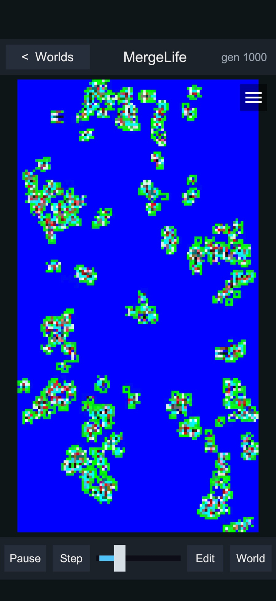

### Select, Paste, Zoo, Undo

- **Select** — Drag out a rectangle; drag its corners and edges (the handles) to resize it. Then **Copy**, **Cut**, **Fill**, **Clear**, **Zoo +** (save it to the zoo), **Shrink** (to the live cells inside), **Fit** (zoom to it), or **Deselect**. A second row turns (**CW**, **CCW**) and mirrors (**Flip H**, **Flip V**) the selection's cells, clears everything **Outside** it, fills it with a **Random** soup (Life-like, Generations, Larger than Life), or pastes the clipboard exactly into it (**Paste In**). **Advance** runs the selection alone one step, and **Advance Out** everything outside it. Copy also puts the pattern's RLE text on the clipboard for the families whose cells are states.
- **Paste** — Arms a translucent ghost of the pattern. Tap to stamp it, as often as you like; drag to move the view. The paste row sets the **paste mode** (**Or**, **Copy**, **Xor**, or **And**, where the family offers them) and the **paste point** (which cell of the pattern you hold: **Middle** or a corner), turns and flips the pattern, and has **Cancel**. If Heaton Life's own clipboard is empty, Paste reads RLE text from the system clipboard — so a pattern copied from LifeWiki in your browser pastes right in. Patterns never cross families (a message explains a refusal); they may cross rules within a family, and the ghost turns amber with a ⚠ note naming the pattern's rule. **Use Its Rule** beside the note switches the world to that rule.
- **Zoo** — The family's pattern library: built-ins (Life's spaceships, oscillators, still lifes, methuselahs, and Gosper gun; HighLife's replicator; Wireworld's clock and diode) plus your saved selections, marked "yours". Patterns from other rules are listed under **Other rules — may not survive here**. Tap a card to arm it for pasting; **×** deletes your own.
- **Undo** and **Redo** — Step back and forward through everything you've done: strokes, stamps, clears, rule and setting changes, resets, selections, and runs (Play to Pause is one step). How far back you can go is set by **Undo memory** in the ☰ menu (128 MB unless you change it).

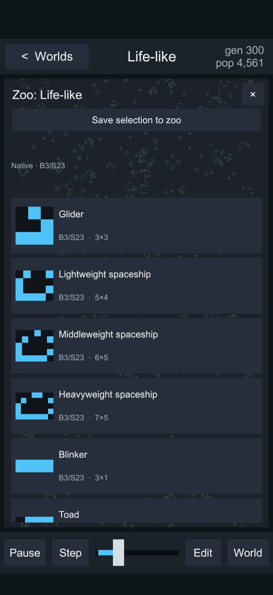

### The timeline

Tap **Record** in the ☰ menu's Timeline row and every step keeps a frame. A bar appears above the transport: **Rec**, **<<** (play backward), **<** (one frame back), the frame readout (`37/120`), a scrubber, **>**, and **>>** (play forward); a tablet's bar adds **Close**, and on a larger tablet **|<** and **>|** for the first and last frames. Moving to a frame shows the world as it was, paused; **Step** then shows the next frame and **Play** plays on past the recording's end. Editing the world at an earlier frame cuts off the frames after it. **Go to…** jumps to a frame and **Close** discards the frames, leaving the world where it is. A timeline keeps 1,000 frames unless you change **Timeline frames**.

## The Unbounded World (HashLife)

The **HashLife** card on the Cellular Automata page opens an unbounded world: Life on a plane with no edges. Patterns of millions of cells run here, and one step can leap any number of generations. A new one starts with the Gosper glider gun; **Preset** cycles through it, the R-pentomino, Acorn, and HighLife's replicator. Giant pattern files open here too.

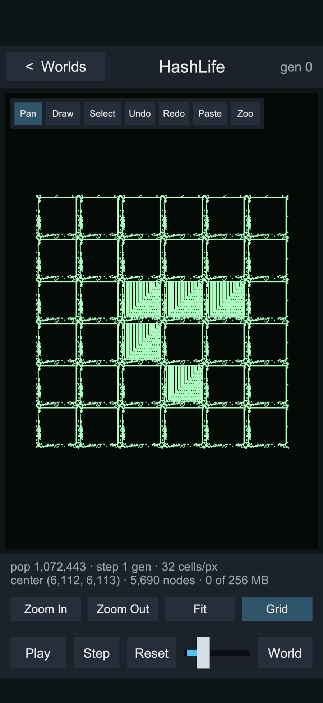

- **The transport bar** holds **Play / Pause**, **Step**, **Reset**, the speed slider, and on a phone **World**, which opens the settings over the canvas (tap it again to close them). A tablet shows the settings panel and **Snapshot** instead, and **Tools** where there's room.
- **The edit bar** is the grid world's: **Pan**, **Draw**, **Select**, **Undo**, **Redo**, **Paste**, **Zoo**. To draw, zoom in until a cell is at least a pixel; an **Ink** row shows a swatch for every state, dead first (paint with the dead one to erase).
- **The status strip** holds **Zoom In**, **Zoom Out**, **Fit**, and **Grid**, and a readout of the population, the step, the scale (`16 cells/px` zoomed out, `4 px/cell` zoomed in), the center cell, and the memory in use.
- **Lost?** When nothing alive is in view, a card says so, points an arrow toward the pattern with its distance in cells, and offers **Fit** to bring it back.

The settings hold **Name**, **Preset**, **Rule** (any Life-like rule, `B0` rules included; on a two-state world **B/S…** opens the rule popup; a rule change keeps the cells), **Step** and **Step base** (a step can be as long as 2^509 generations), **Hyperspeed** (while playing, the step grows each time a full base of steps passes quickly, as far as memory allows), **Auto fit**, **Stop if dead**, **Generation**, **Memory** (how much the world may use: more makes big patterns faster and never changes the results; 256 MB to start), **Timeline** and **Frames**, the display rows, the paste rows, **Reset** and **Snapshot**, **Export RLE** and **Export .mc**, **Pattern info**, and **Grid world**: **Open** makes a new grid world around the live cells. The other way, **Open as unbounded world** in a grid world's ☰ menu puts its cells on a new unbounded plane.

The plane also runs History and Super rules (type one into the Rule field and the world converts), Generations rules, rule tables, and Wireworld, which arrive from files or from a grid world.

## Importing Patterns

Heaton Life reads the pattern formats used across the Life community (for example, patterns downloaded from LifeWiki), recognizing each by its content, and opens each as a world of the right family:

| Format | File endings | Opens as |
|---|---|---|
| RLE | `.rle`, `.txt` | A world of its rule's family: Life-like, Generations, Larger than Life, Rule Table, or Wireworld |
| Macrocell | `.mc`, `.mc.gz` | An unbounded world |
| Plaintext | `.cells` | Life-like |
| Life 1.05 and 1.06 | `.lif`, `.life` | Life-like |
| MCell | `.mcl` | Life-like, Generations, or Larger than Life |
| Rule file | `.rule` | A Rule Table world of that rule |
| PNG | `.png` | A MergeLife world, for a PNG exported from one; otherwise a picture of a pattern (white is dead, any other color alive) |
| BMP | `.bmp` | A picture of a pattern |
| gzip and zip | `.gz`, `.zip` | What they hold (from a zip, pick one file) |

The ways in:

1. **Import** on the library screen opens your device's file picker — the **Files** app on iPhone and iPad, the system document picker on Android — so a pattern you downloaded in your browser is one tap away. (Android shows every file, because pattern files have no registered file type; picking something that isn't a pattern simply reports an error.)
2. **Share to Heaton Life** (iPhone and iPad): from the Files app, Safari, or Mail, share an `.rle`, `.txt`, `.mc`, `.cells`, `.lif`, `.life`, `.mcl`, `.rule`, or `.png` file and choose **Heaton Life** — it opens as a new world.
3. **MENU > New World from Clipboard**: copy a pattern's text — a LifeWiki code block, a forum post — or a selection in Heaton Life, and it becomes a world of its own.
4. **Paste inside a world**: copy a pattern's RLE text, then use the edit bar's **Paste** tool in a matching world to stamp it wherever you like.

A very large pattern asks whether to open in HashLife or as a grid world; one too large for any grid can open only in HashLife. A file's name, author, and comments stay with its world: **Pattern info** in the ☰ menu shows them.

## Exporting Patterns

- **Export RLE** (in the world's settings) writes a Life-like, Generations, Larger than Life, Rule Table, Wireworld, or Cyclic world's live cells as a pattern file; **Export RLE** and **Export .mc** (Macrocell, with its timeline) do the same in an unbounded world. After saving, your device's file picker offers to save a copy wherever you like — on Android, that is the way to get a file out of the app.
- **Export PNG ×4** (MergeLife) saves the world's lattice as a PNG at four times its size, which can be imported again as a world. It goes to the Snapshots folder.

## Snapshots

**Save snapshot (PNG)** in a world's **☰** menu (or **Snapshot** on a tablet, in an unbounded world's settings, or in a fractal) saves a picture of the current view, named `heatonlife-<family>-<date>-<time>.png`.

- **iPhone and iPad:** Open the **Files** app → **On My iPhone** (or **On My iPad**) → **Heaton Life** → **Snapshots**. From there you can share, save to Photos, or AirDrop them. Your worlds library lives in the same place.
- **Android:** Snapshots are written to the app's private folder, `Android/data/com.heatonresearch.heatonlife/files/Snapshots`, which you can browse from a computer over USB.

## Fractals

Fractals are the picker's fourth category. Each one you open is an **expedition** — a viewpoint saved in your library like any world. Four sets with presets: **Mandelbrot**, **Julia**, **Burning Ship**, and **Newton**.

- **Tap** to recenter on a point (a crosshair marks the new center until the frame arrives), **drag** to pan, **pinch** to zoom — the image stays glued to your fingers.
- The status bar's **Zoom In**, **Zoom Out**, **Home**, **Auto**, and **Snapshot** buttons (**In**, **Out**, and **Snap** on a phone) zoom at the center, return to the home view, start a hands-free dive toward the nearest interesting boundary (tap **Stop**, or any gesture, to end it), and save a snapshot.
- Deep frames take longer on a phone: a **rendering…** chip shows the percentage, with **Cancel** to abandon a frame and reset the iteration budget. The settings hold **Preset**, **Colormap**, **Max iter** (raised automatically as you dive), and **Name**; Julia adds its constant **c**, Newton its **Degree**.

Zoom goes to 10¹² — a trillion times.

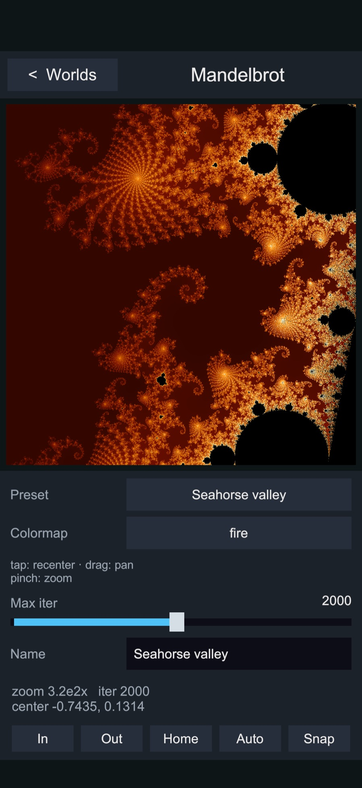

## Evolving MergeLife Rules

**MENU > Evolve MergeLife** opens the evolver: a genetic algorithm that breeds MergeLife rules and scores each one by how interesting its world stays over time.

- **Start / Stop** — Begins a search from a fresh random population. The search runs only while Heaton Life is in the foreground; it pauses when you switch away and resumes when you return. Leaving the screen with **< Catalog** stops it.
- **Population**, **Steps per run**, **Eval cycles** — The search's size and patience. A phone has fewer cores than a desktop, so expect a slower search; lowering **Steps per run** speeds it up at the cost of rougher scores.
- **Keep above** — The score a rule must reach to be kept (scores run up to 5.0; the default 3.5 is the historical "worth saving" bar).

The preview runs the current best rule live above a leaderboard. A stalled population is automatically replaced by a fresh run (the `run 3` `stall 39/250` line counts down to it), and each run's champion is kept if it clears the bar.

- **Create world from best** — Opens the current best rule as a new saved world. **Copy rule** — Copies its rule code.
- **Finds** — Every kept rule, best first, each card running live; **Refresh** brings in new arrivals (`+3 new`), **Clear** empties the log, **×** removes one. Tap a card to open it as a **preview world** while the search keeps going, then **Create as World** to keep it or **Delete World** (or **< Evolve**) to discard. Finds persist between launches.

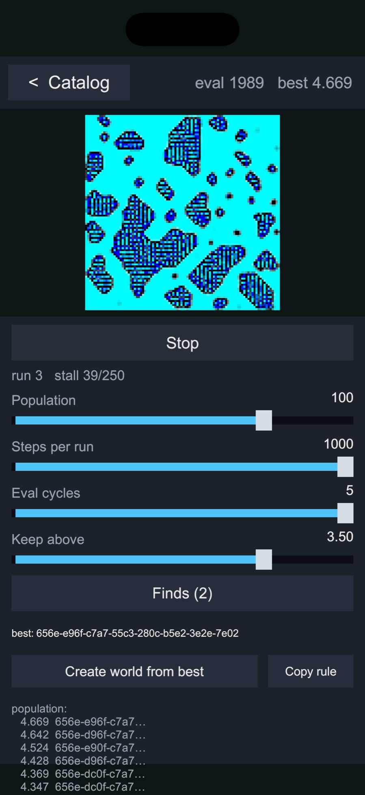

## Tips

- **A pasted pattern dies immediately** — It was captured under a different rule; same family, different physics. Tap **Use Its Rule**, or try a world with the rule named on its zoo card.
- **"Paste rejected"** — Patterns belong to a family; a Life pattern pastes into Life-like worlds only.
- **I'm lost on the unbounded plane** — Tap **Fit**, on the card that appears or on the status strip.
- **A fractal frame never finishes** — Tap **Cancel**; it also resets a hand-cranked **Max iter**.
- **I can't find the editing tools** — Tap **Edit** on the transport bar (phone) or **Tools** (tablet).
- **The settings panel is gone** — It's folded: tap the tab at the edge of the canvas (tablet).
- **"Not undoable"** — The change was bigger than the undo memory; raise **Undo memory** in the ☰ menu.
- **Getting help** — **MENU > Heaton Life Manual** opens this guide; **About** shows the version and builds to include in a report.

---

*Heaton Life is provided under the Apache 2.0 License. MergeLife is described in Jeff Heaton's 2017 paper, "Evolving Continuous Cellular Automata for Aesthetic Objectives" (arXiv:1809.00656).*
